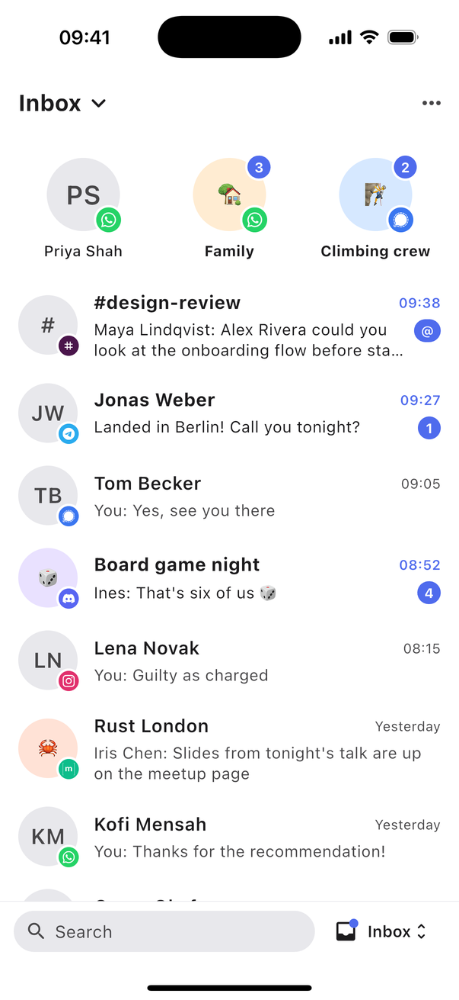
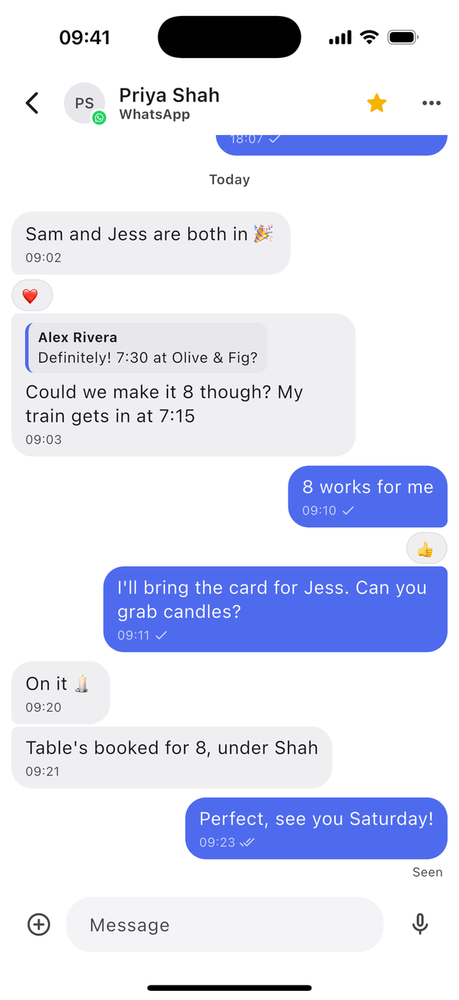
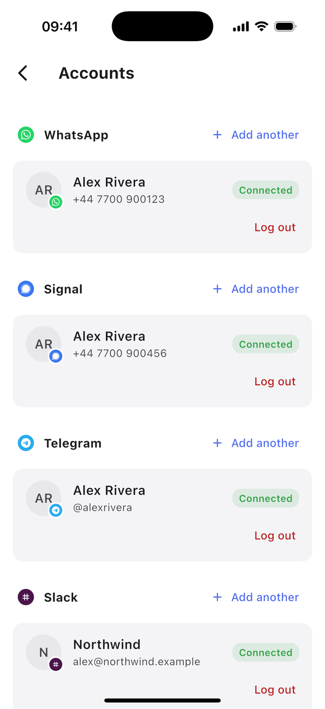
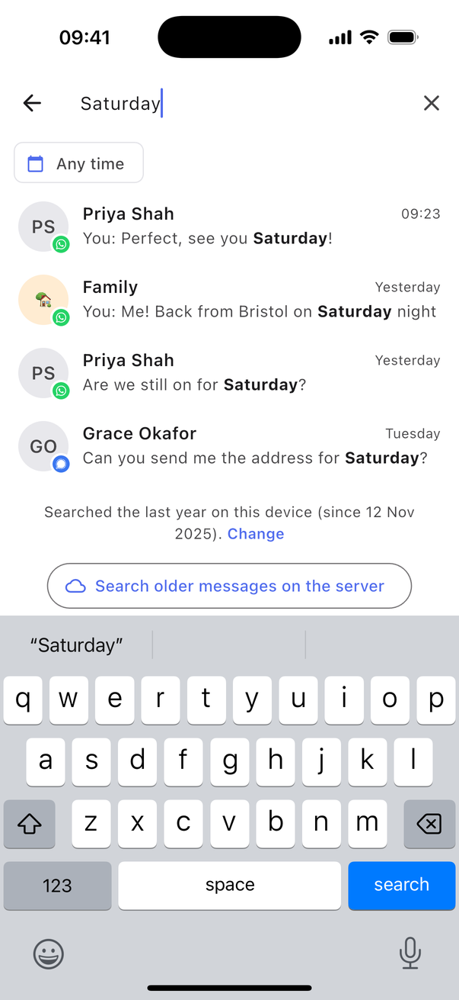
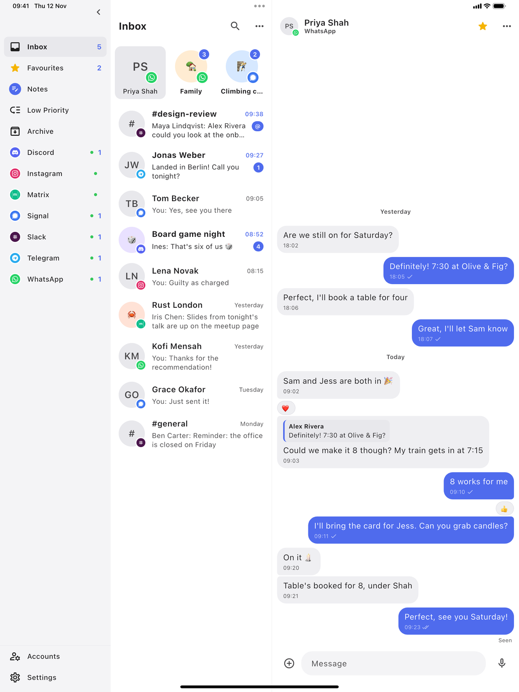
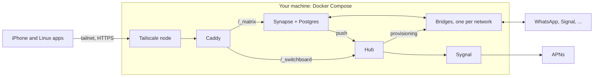

<p align="center">
  
</p>

<h1 align="center">Switchboard</h1>

<p align="center">
  A self-hosted chat inbox: WhatsApp, Signal and other networks in one app,
  bridged through a Matrix server you run yourself.
</p>

<p align="center">
  <a href="LICENSE"></a>
  
  
  
</p>

<p align="center">
  
  
  
  
</p>

Switchboard is a self-hosted alternative to Beeper. The backend is a Matrix
homeserver (Synapse) with one [mautrix](https://docs.mau.fi/bridges/) bridge
per chat network, run by Docker Compose and reached only over your
[Tailscale](https://tailscale.com) network. The app, written in Flutter over a
Rust core built on [matrix-rust-sdk](https://github.com/matrix-org/matrix-rust-sdk),
puts every network in one inbox on iOS and Linux. There is no Beeper account
and no third-party server in the message path.

It is a personal project, built for one person's daily use and published as
it stands. See [Status](#status) before you rely on it.

On an iPad, or a desktop window at least 900 pixels wide, the app shows a
sidebar of views and networks, the chat list and the conversation side by
side:

<p align="center">
  
</p>

The screenshots show a demo server with made-up people and chats
([`app/tool/demo`](app/tool/demo)).

## Features

**Inbox**

- One inbox for every linked network, newest first, with a network badge on
  each chat and unread and mention counts.
- Views for each network and, where a network has several, each account.
- Favourites as a grid at the top, in an order you drag.
- Archive (a chat comes back when someone writes), Low Priority (only
  mentions and replies notify), mark as read or unread, mark all as read.
- Swipe, press-and-hold and multi-select actions on phones; right-click and
  keyboard shortcuts on the desktop.
- Note to Self, plus a Notes view that gathers each network's own self-chat.
- Discord and Slack bring in direct messages, plus the channels you choose
  in Settings, per account and at any time. Turning a channel off keeps the
  chat and its history.

**Conversations**

- Replies, reactions, edits and unsend, offered only where the network
  supports them (from the bridge's declared capabilities).
- Delivery status from the bridge, with the reason and a retry when a message
  fails; "Seen" and typing indicators.
- Formatted text, @mentions and link previews.
- Photos, videos, files and voice notes, sent and received, with voice notes
  recorded in the app. Videos and audio play in place.
- Forward and share photos and videos; save them to Photos (iOS) or
  Downloads (Linux).

**Search and media**

- Search across all chats from an index kept on the device, with a date
  filter, and a fallback to the server's search for older messages.
- A page per chat of its shared media, files and links.

**Accounts**

- Link, relink and log out of network accounts from inside the app. One
  generic renderer drives every bridge's login steps: QR codes, pairing
  codes, forms and in-app web sign-in. A link made on one device works on all
  of them, because the session lives on the server.
- Several accounts per network.
- Live connection status for every account, and a banner when one needs
  relinking.

**Platforms**

- **iOS**: push notifications through your own Sygnal gateway (needs a paid
  Apple Developer account), with a notification service extension that
  fetches the message over your tailnet, so message text never travels in
  the push.
- **Linux**: a three-pane layout, tray icon, desktop notifications, start at
  login, drag-and-drop and paste for files, and keyboard shortcuts.

**Experimental**: one-to-one Signal voice and video calls, through a patched
Signal bridge and Signal's [RingRTC](https://github.com/signalapp/ringrtc).

## Supported networks

Every network goes through a bridge built on mautrix's bridgev2 framework,
so the app links them all the same way. `sb bridges` lists the catalogue in
[`deploy/bridges.yaml`](deploy/bridges.yaml).

| Network | Bridge | Status |
| --- | --- | --- |
| WhatsApp | mautrix-whatsapp | Working |
| Signal | mautrix-signal, patched in [`bridges/signal`](bridges/signal) | Working |
| Matrix (other homeservers) | `sb-matrix`, Switchboard's own, in [`bridges/matrix`](bridges/matrix) | Working against a test server; not yet with a real recovery key |
| Instagram | mautrix-meta (Instagram) | Untested: runs on the author's server; in-app login not yet tried end to end |
| Slack | mautrix-slack, patched in [`bridges/slack`](bridges/slack) | Untested: runs on the author's server; in-app login not yet tried end to end |
| Discord | mautrix-discord (bridgev2 rewrite), patched in [`bridges/discord`](bridges/discord) | Untested: runs on the author's server; in-app login not yet tried end to end |
| Telegram | mautrix-telegram | Untested: needs your own API ID from my.telegram.org |
| Messenger | mautrix-meta | Untested |
| X | mautrix-twitter | Untested |
| LinkedIn | mautrix-linkedin | Untested |
| Google Messages | mautrix-gmessages | Untested: needs an Android phone |
| Bluesky | mautrix-bluesky | Untested |
| Google Voice | mautrix-gvoice | Untested: US numbers only |
| iMessage | mautrix-imessage | Planned: needs a Mac signed in to your Apple ID |
| Google Chat | mautrix-googlechat | Planned: legacy bridge, linked through bot commands |

"Untested" means the bridge is in the catalogue and `sb enable` starts it,
but it hasn't been used with a real account through Switchboard yet.

## How it works



- A **Tailscale** sidecar joins your tailnet as the node `switchboard` and
  serves HTTPS with its `*.ts.net` certificate. Every device reaches the
  backend through it; nothing is exposed to the internet.
- **Caddy** sends Matrix traffic to **Synapse** and `/_switchboard` to the
  **Hub**, and refuses Synapse's admin API and federation endpoints.
- Each **bridge** signs in to its network as you and mirrors your chats into
  Synapse as Matrix rooms, with one ghost user per contact.
- The **Hub** is a small Go service: it gives the app one API for every
  bridge's account linking and connection status, and, for iOS push, sits in
  front of Sygnal to hold back pushes for history a bridge imports.
- The **app** is a Flutter UI over a Rust core (`switchboard_core`) that owns
  all the Matrix logic: sliding sync, timelines, the offline send queue and
  the search index.

The full design, including parts not built yet, is in
[docs/spec.md](docs/spec.md).

## Privacy and security

- **Self-hosted.** Synapse, Postgres, the bridges and the Hub run on your own
  machine. Your messages pass through the networks you link and your server,
  and nowhere else.
- **Tailnet only.** Devices reach the server over Tailscale. Federation is
  off, registration is closed, and the only host port is Caddy on
  `127.0.0.1:8080`, for checks from the machine itself.
- **Where messages are stored.** On the server, in Synapse's Postgres
  database and media volume. Bridged rooms aren't end-to-end encrypted
  between the app and the bridges (bridge encryption is off), which keeps
  server-side search working; the connections are WireGuard and TLS, and at
  rest the data relies on your machine's disk encryption. The bridges'
  databases hold your network sessions, so guard the Docker volumes as you
  would the accounts themselves.
- **On your devices.** The app keeps a local cache in matrix-rust-sdk's
  SQLite store, encrypted with a random 32-byte key held in the iOS Keychain
  or the Linux Secret Service. The search index is a separate SQLite file
  that relies on the platform's own storage encryption.
- **Push.** Pushers are `event_id_only` and Synapse includes no message
  content, so a push carries only room and event IDs and an unread count; the
  iOS extension fetches the message itself over your tailnet.
- **No telemetry.** Neither the app nor `sb` collects usage data, and
  Synapse's stats reporting is off.

The bridges reach their networks through unofficial clients; see the
[Disclaimer](#disclaimer).

## Requirements

**Backend**

- Docker with Compose v2. Switchboard is developed and run on macOS with
  Docker Desktop; other Docker hosts should work but are untested.
- Go 1.27 or later, to build the `sb` command.
- A [Tailscale](https://tailscale.com) account, an auth key for the server
  node, and Tailscale on every device that uses the app.
- For iOS push: a paid Apple Developer account and an APNs key.

**Apps**

- Flutter 3.47.9.
- Rust 1.99.1 or later through rustup (the build uses the `stable`
  toolchain), with the iOS targets for iOS builds.
- iOS: Xcode and CocoaPods. App Store Connect uploads need Xcode 26.
- Linux: GTK 3, WebKitGTK 4.1, libsecret, mpv, libayatana-appindicator,
  FFmpeg and PulseAudio (see [`packaging/arch/PKGBUILD`](packaging/arch/PKGBUILD)).

## Quick start

Build `sb`, then let it set up the backend from `deploy/`:

```sh
make sb                                   # builds bin/sb
cd deploy
../bin/sb init --owner alice              # secrets, configs, databases, your account
../bin/sb tailscale-key tskey-auth-...    # join your tailnet as "switchboard"
../bin/sb enable whatsapp signal          # start the bridges you want
../bin/sb test                            # smoke test: Synapse, Hub, every bridge
../bin/sb secret get ADMIN_PASSWORD       # your account's password
```

`sb init` takes the server's URL from your tailnet's name
(`https://switchboard.<tailnet>.ts.net`), or from `--public-url`. It writes
the install's settings to `deploy/switchboard.yaml`, which is git-ignored. To
write them by hand instead, copy
[`deploy/switchboard.example.yaml`](deploy/switchboard.example.yaml) to
`deploy/switchboard.yaml`, fill it in and run `sb init`.

Your Matrix account is `@alice:switchboard.internal`, and the server name
can't change later. `sb bridges` lists every network and `sb help` every
command. Telegram needs an API ID and hash first:
`sb secret set TELEGRAM_API_ID ...` and `sb secret set TELEGRAM_API_HASH ...`.

For iOS push, put your APNs key at `deploy/secrets/apns.p8` and run
`sb push <KEY_ID> <TEAM_ID> <BUNDLE_ID>`.

Then sign in from the app with your server, `alice` and the password, and
link your accounts under Accounts.

## Building the apps

The sign-in screen can fill in your server. Put it in `app/tool/local.env`,
which is git-ignored; the build scripts and the Arch package read it:

```sh
echo 'SB_DEFAULT_SERVER=switchboard.example.ts.net' > app/tool/local.env
```

**iOS**

```sh
cd app
flutter run --dart-define-from-file=tool/local.env    # Simulator or a connected iPhone
```

The Xcode project carries the author's bundle ID
(`com.richarddraycott.switchboard`) and no team. To build for a device, put
your team in `app/ios/Flutter/Local.xcconfig`, which is git-ignored, and set
your own bundle ID; [docs/DEVELOPMENT.md](docs/DEVELOPMENT.md#ios) lists where
the bundle ID appears. Use the same bundle ID with `sb push`.

```sh
echo 'DEVELOPMENT_TEAM = ABCDE12345' > app/ios/Flutter/Local.xcconfig
```

[`app/tool/testflight.sh`](app/tool/testflight.sh) archives a release and
uploads it to TestFlight.

**Linux**

```sh
cd app
flutter build linux --release --dart-define-from-file=tool/local.env
```

On Arch, `yay -Bi packaging/arch` builds and installs a package from the
committed `HEAD`.

Both builds compile the Rust core through cargokit, so the first one takes a
while. More on tests, tooling and the code in
[docs/DEVELOPMENT.md](docs/DEVELOPMENT.md).

## Project layout

| Path | What |
| --- | --- |
| [`sb/`](sb) | Go: the `sb` CLI (`cmd/sb`) and the Hub (`cmd/hub`) |
| [`deploy/`](deploy) | The Compose project: bridge catalogue, pinned versions, config overlays and templates |
| [`bridges/signal/`](bridges/signal) | mautrix-signal at a pinned tag, with Switchboard's patches |
| [`bridges/discord/`](bridges/discord), [`bridges/slack/`](bridges/slack) | mautrix-discord and mautrix-slack, pinned, with the per-channel bridging the app's Settings use |
| [`bridges/matrix/`](bridges/matrix) | `sb-matrix`, a bridgev2 connector for accounts on other Matrix servers |
| [`core/`](core) | `switchboard_core`, the Rust core over matrix-rust-sdk |
| [`app/`](app) | The Flutter app for iOS and Linux |
| [`packaging/arch/`](packaging/arch) | Arch Linux package |
| [`docs/`](docs) | Design spec, progress notes and developer guide |

## Status

Switchboard is pre-release software. Its author uses it on an iPhone; the
Linux app works but has had less use.

- **Built**: the backend and `sb`, the iOS app with push, the Linux app, and
  everything under [Features](#features).
- **Not built yet**: Android and macOS apps; reminders and send later;
  backups, updates and health checks in `sb` (`sb backup`, `sb update`,
  `sb doctor` in the spec); AppImage and `.deb` packages.
- **Single user** by design: one owner account per server.

Progress notes are in [docs/m1-progress.md](docs/m1-progress.md) and
[docs/m2-progress.md](docs/m2-progress.md).

## Contributing

Issues and pull requests are welcome. Before opening a pull request, run the
tests for what you changed:

```sh
make test                        # sb and the Hub: go vet and go test
(cd core && cargo test --lib)    # the Rust core
(cd app && flutter test)         # the app
```

If you change the Rust API in `core/src/api`, regenerate the bindings with
`flutter_rust_bridge_codegen generate` in `app/`. Contributions are accepted
under the project's licence, AGPL-3.0-or-later.

## Licence

Copyright (c) 2026 Richard Draycott

Switchboard's own code is licensed under the GNU Affero General Public License,
version 3 or (at your option) any later version (AGPL-3.0-or-later). The full
text is in [LICENSE](LICENSE).

The app links Signal's RingRTC and libsignal (AGPL-3.0-only), and the Signal
bridge in `bridges/signal` patches mautrix-signal (AGPL-3.0-or-later), so
builds that include them are covered by version 3 of the AGPL as a whole.
`bridges/discord` and `bridges/slack` patch mautrix-discord and mautrix-slack
(both AGPL-3.0-or-later) the same way.
Third-party code, assets and the container images the backend runs are listed
in [THIRD_PARTY_NOTICES.md](THIRD_PARTY_NOTICES.md).

## Acknowledgements

Switchboard stands on other people's work:

- The [mautrix bridges](https://github.com/mautrix) and
  [mautrix-go](https://github.com/mautrix/go), which do the hard part of
  talking to each network.
- [Matrix](https://matrix.org), [Synapse](https://github.com/element-hq/synapse),
  [Sygnal](https://github.com/element-hq/sygnal) and
  [matrix-rust-sdk](https://github.com/matrix-org/matrix-rust-sdk).
- Signal's [RingRTC](https://github.com/signalapp/ringrtc) and
  [libsignal](https://github.com/signalapp/libsignal), for Signal calls.
- [Flutter](https://flutter.dev),
  [flutter_rust_bridge](https://github.com/fzyzcjy/flutter_rust_bridge),
  [media_kit](https://github.com/media-kit/media-kit) and
  [Simple Icons](https://simpleicons.org).

## Disclaimer

Switchboard is not affiliated with, endorsed by or sponsored by Beeper, the
Matrix.org Foundation, Tailscale, Meta, WhatsApp, Signal, Apple, Google,
Discord, Slack, X, LinkedIn, Telegram, Bluesky or Reddit. Their names and
logos are trademarks of their respective owners.

The bridges connect to the chat networks through unofficial clients, which may
break the networks' terms. Accounts used with them can be restricted or
banned. Use Switchboard at your own risk.
